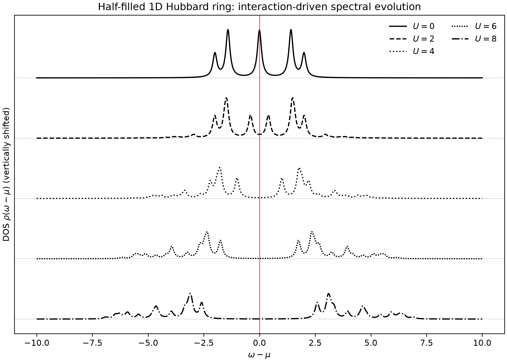
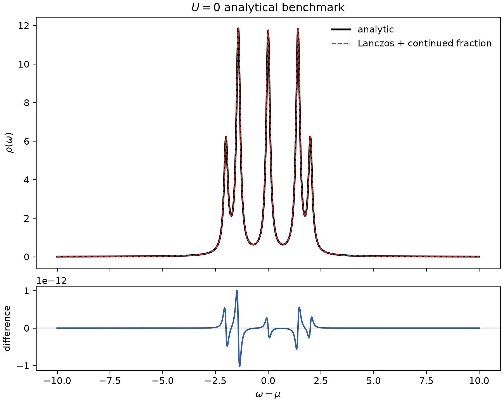
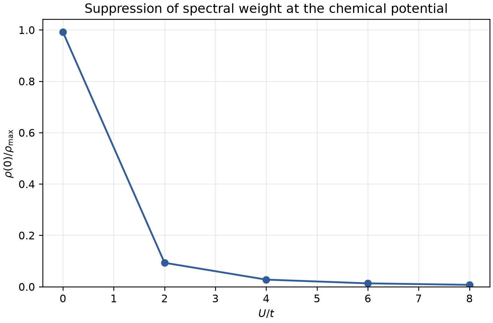
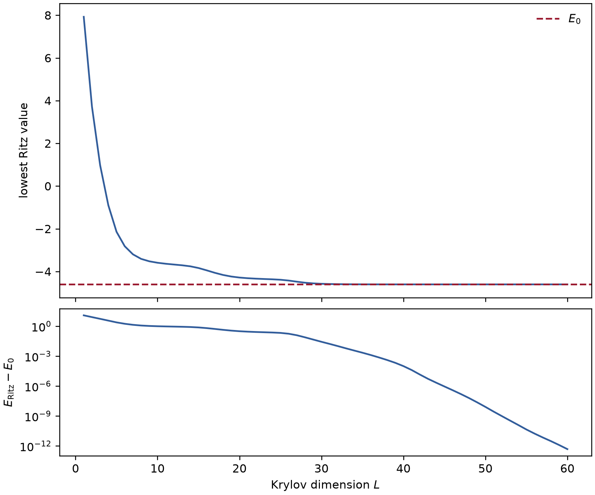

# Homework 3 数值结果

本文件集中记录 `run_homework3.py` 在固定随机种子 `20260928` 下产生的结果。
主参数为

$$
N=8,\qquad t=1,\qquad U=4,\qquad \eta=0.11,
\qquad (N_\uparrow,N_\downarrow)=(4,4).
$$

所有数值均来自已执行的源码。自动测试为 **24/24 通过**，结果校检为
**30/30 通过**。

## 1. 分块、Hamiltonian 与基态

| 量 | 结果 |
|---|---:|
| 组合公式给出的块维数 | 4900 |
| 实际枚举维数 | 4900 |
| 基态能量 $E_0$ | -4.60352629998921 |
| 基态简并度（容差 $10^{-8}$） | 1 |
| 基态相对残差 | $1.5443\times10^{-14}$ |
| matrix-free / 独立 CSR 相对作用误差 | $1.2493\times10^{-16}$ |
| $\lVert H-H^\dagger\rVert$ | 0 |
| 相互作用 trace：期望 / 实测 | 39200 / 39200 |
| 两种 Hamiltonian 表示所得 $E_0$ 之差 | $2.1316\times10^{-14}$ |

## 2. Lanczos 前六组系数

采用 $b_0=0$。`b_(m+1)` 列给出通往下一 Krylov 向量的耦合；
$T_6$ 使用 $b_1,\ldots,b_5$，而 $b_6$ 用于末列残差。

| $m$ | $a_m$ | $b_m$ | $b_{m+1}$ |
|---:|---:|---:|---:|
| 0 | 7.9696938017 | 0 | 4.2473265360 |
| 1 | 8.0882816689 | 4.2473265360 | 5.4562485018 |
| 2 | 8.1100438218 | 5.4562485018 | 5.8829236759 |
| 3 | 8.2947849533 | 5.8829236759 | 6.4975269813 |
| 4 | 7.9676999431 | 6.4975269813 | 6.6118019978 |
| 5 | 8.0112260463 | 6.6118019978 | 6.6138816472 |

$$
T_6=\begin{pmatrix}
7.9697&4.2473&0&0&0&0\\
4.2473&8.0883&5.4562&0&0&0\\
0&5.4562&8.1100&5.8829&0&0\\
0&0&5.8829&8.2948&6.4975&0\\
0&0&0&6.4975&7.9677&6.6118\\
0&0&0&0&6.6118&8.0112
\end{pmatrix}.
$$

| 校检 | 实测残差 |
|---|---:|
| $\lVert Q^\dagger Q-I\rVert$ | $6.850\times10^{-16}$ |
| 已完整构造列的 $HQ-QT$ | $7.891\times10^{-15}$ |
| 加入 $b_6q_6$ 后的完整递推 | $8.262\times10^{-15}$ |

若从严格基态开始，精确算术中 Krylov 空间维数为 1：第一次去掉
$a_0\lvert\Phi_0\rangle$ 后残差为零，递推随即停止。

## 3. 连分数与直接求解

最长 Krylov 链使用 480 步。

| $z$ | 连分数值 | 直接求解值 | 绝对偏差 |
|---|---:|---:|---:|
| $0.7+0.11i$ | $-0.067064955-0.00052123791i$ | $-0.067064955-0.00052123791i$ | $1.084\times10^{-19}$ |
| $-1.3+0.11i$ | $-0.058888929-0.00039279886i$ | $-0.058888929-0.00039279886i$ | $1.388\times10^{-17}$ |
| $5+0.11i$ | $-0.09679507-0.0034958612i$ | $-0.096795069-0.0034958617i$ | $1.133\times10^{-9}$ |

误差随 Lanczos 步数的变化：

| $L$ | $z=0.7+0.11i$ | $z=-1.3+0.11i$ | $z=5+0.11i$ |
|---:|---:|---:|---:|
| 4 | 1.242e-5 | 2.396e-6 | 3.943e-3 |
| 8 | 1.577e-5 | 6.438e-7 | 2.346e-3 |
| 16 | 4.126e-6 | 6.655e-7 | 2.766e-3 |
| 32 | 4.145e-6 | 7.944e-7 | 3.275e-3 |
| 64 | 4.340e-7 | 1.254e-11 | 1.204e-3 |
| 128 | 4.631e-10 | 1.388e-17 | 2.467e-4 |
| 256 | 1.084e-19 | 1.388e-17 | 4.834e-6 |
| 480 | 1.084e-19 | 1.388e-17 | 1.133e-9 |

$z=5+0.11i$ 靠近高能谱结构，因此比另两个频率需要更长的 Krylov 链。

## 4. 总态密度与权重

| $U$ | $w_{\rm add}$ | $w_{\rm rem}$ | $\mu$ |
|---:|---:|---:|---:|
| 0 | 8.000000000000005 | 8.000000000000007 | $3.553\times10^{-15}$ |
| 2 | 7.999999999999994 | 7.999999999999995 | 1.000000000000007 |
| 4 | 8.000000000000021 | 8.000000000000021 | 2.000000000000002 |
| 6 | 7.999999999999984 | 7.999999999999984 | 3.000000000000001 |
| 8 | 7.999999999999996 | 7.999999999999995 | 4.000000000000002 |

主结果为

$$
\mu=2,\qquad w_{\rm add}=8,\qquad w_{\rm rem}=8.
$$

粒子-空穴对称性直接按
$\rho_{\rm add}(\xi)=\rho_{\rm rem}(-\xi)$ 在对称频率网格上逐点比较，
并以两条谱中较大的峰值归一：

| $U$ | 逐点相对最大偏差 |
|---:|---:|
| 0 | $4.521\times10^{-14}$ |
| 2 | $5.793\times10^{-8}$ |
| 4 | $3.382\times10^{-7}$ |
| 6 | $3.180\times10^{-7}$ |
| 8 | $1.577\times10^{-12}$ |

## 5. $U=0$ 解析基准

自由费米子解析谱为

$$
\rho(\omega)=2\sum_k\frac{1}{\pi}
\frac{\eta}{(\omega-\epsilon_k)^2+\eta^2},\qquad
\epsilon_k=-2t\cos\frac{2\pi k}{N}.
$$

相对于解析峰值归一的最大偏差为

$$
\boxed{8.6674\times10^{-14}}.
$$

## 6. 选做：简并陷阱

| $N$ | $U$ | 简并度 | 闭壳层隙 | 完整求和 | 一格点×$N$ 原始值 | 最大偏离量级 |
|---:|---:|---:|---:|---:|---:|---:|
| 8 | 0 | 4 | $4.90\times10^{-16}$ | 8 / 8 | 6 / 10 | $2.00\times10^{0}$ |
| 8 | 4 | 1 | 不适用 | 8 / 8 | 8 / 8 | 0（机器精度内） |

原始值 6/10 对应程序在简并基态空间中选出的当前基矢；换取另一组简并子空间
基矢时，这两个分量可能改变，因此不能把 6/10 当成基矢无关的物理量。表中同时
保留相对完整 8/8 结果的最大偏离量级 $2.00\times10^0$，作为不区分偏离
落在加谱或减谱一侧的稳健诊断指标；该指标仍针对当前选态，并不宣称完全消除
简并基矢依赖。$N=6,U=0$ 的闭壳层对照中，快捷法相对完整结果的最大偏离
仅为 $8.882\times10^{-16}$。

## 7. 选做：Mott 谱演化

| $U$ | $\rho(0)$ | $\rho_{\max}$ | $\rho(0)/\rho_{\max}$ | $\mu$ |
|---:|---:|---:|---:|---:|
| 0 | 11.74902755 | 11.84593085 | 0.991819697 | 0 |
| 2 | 0.919488892 | 9.884346144 | 0.093024756 | 1 |
| 4 | 0.209671658 | 7.613997057 | 0.027537659 | 2 |
| 6 | 0.086398597 | 6.648692822 | 0.012994825 | 3 |
| 8 | 0.044751281 | 6.274029512 | 0.007132781 | 4 |

有限尺寸和 $\eta=0.11$ 的 Lorentzian 展宽使隙内保留非零尾部，但
$\rho(0)/\rho_{\max}$ 随 $U$ 显著下降。

## 8. 选做：Krylov 维数收敛

| $L$ | 最低 Ritz 值 | 与 $E_0$ 的差 |
|---:|---:|---:|
| 1 | 7.92524614 | 12.528772 |
| 5 | -2.14246671 | 2.4610596 |
| 10 | -3.5907705 | 1.0127558 |
| 20 | -4.2837792 | 0.31974711 |
| 30 | -4.5756616 | 0.0278647 |
| 40 | -4.6034248 | $1.0149\times10^{-4}$ |
| 50 | -4.6035263 | $8.285\times10^{-9}$ |
| 60 | -4.6035263 | $4.832\times10^{-13}$ |

| $L$ | 相对 480 步完全再正交参考链的最大差异 |
|---:|---:|
| 10 | 0.37670844 |
| 20 | 0.18282149 |
| 40 | 0.02766725 |
| 60 | 0.01005857 |

能量在 $L=60$ 已收敛到约 $10^{-12}$。谱形的 1.006% 是 $L=60$
与同一初始向量产生的 480 步完全再正交参考链之间的自参照差异，不是相对于
精确谱的严格误差。若 480 步参考已进入收敛区，真实谱形误差应更小；这里将
1.006% 作为保守的收敛指标，而不把它解释为严格误差界。

## 9. 校检汇总

| 校检类别 | 期望 | 实测 | 结论 |
|---|---:|---:|---:|
| 分块维数 | 组合公式一致 | 4900 | 通过 |
| matrix-free / CSR | 相对误差 < $10^{-12}$ | $1.249\times10^{-16}$ | 通过 |
| 厄米性 | 残差 < $10^{-12}$ | 0 | 通过 |
| 相互作用 trace | 39200 | 39200 | 通过 |
| 基态残差 | < $10^{-9}$ | $1.544\times10^{-14}$ | 通过 |
| Lanczos 正交性 | < $10^{-10}$ | $6.850\times10^{-16}$ | 通过 |
| Lanczos 递推 | < $10^{-10}$ | $8.262\times10^{-15}$ | 通过 |
| 连分数 / 直接求解 | < $10^{-8}$ | $1.133\times10^{-9}$ | 通过 |
| $U=0$ 解析谱 | < $10^{-8}$ | $8.667\times10^{-14}$ | 通过 |
| 粒子-空穴逐点对称 | $\rho_{\rm add}(\xi)=\rho_{\rm rem}(-\xi)$ | 最大 $3.382\times10^{-7}$ | 通过 |
| Ritz 单调性 | 单调不升 | 最大违反量 0 | 通过 |

故障注入结果：翻转跳跃符号的作用差为 `0.6680882`，删除周期边界键的作用差为
`0.11750682`，删除 $U$ 项使 trace 偏差达到 `39200`。

完整 30 条校检见 [`data/validation_checklist.csv`](data/validation_checklist.csv)，
机器可读结果见 [`data/all_results.json`](data/all_results.json)。

