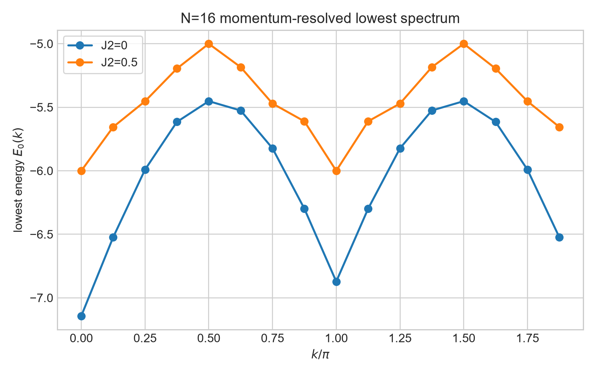
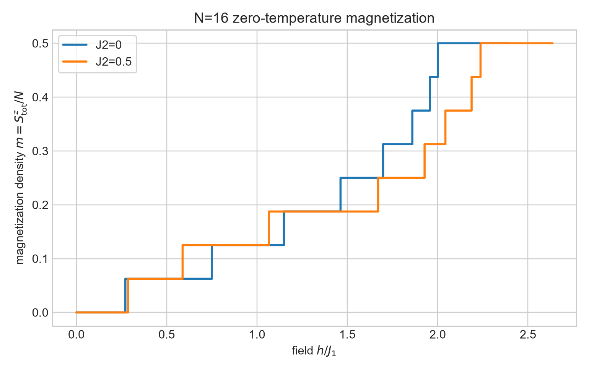
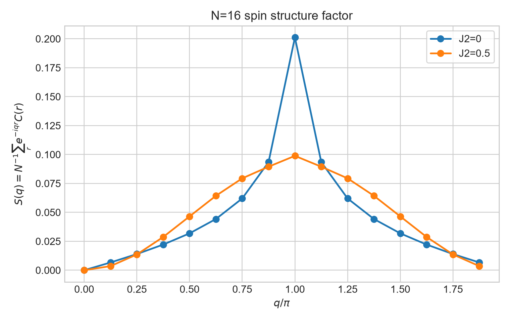
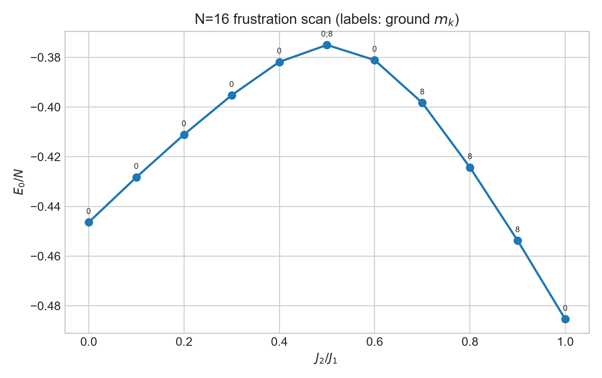

# 第四次作业数值结果

## 1. 模型、基与符号约定

计算模型为周期边界的自旋 $1/2$ $J_1$-$J_2$ XXZ 链：

$$
H=J_1\sum_j\left(S_j^xS_{j+1}^x+S_j^yS_{j+1}^y+\Delta S_j^zS_{j+1}^z\right)
+J_2\sum_j\left(S_j^xS_{j+2}^x+S_j^yS_{j+2}^y+\Delta S_j^zS_{j+2}^z\right).
$$

主计算取 $N=16$、$J_1=1$、$\Delta=1$，比较 $J_2=0$ 与 $J_2=0.5$。位 $j$ 对应格点 $j$，`1` 表示自旋向上。固定 $n_\uparrow$ 后有 $S^z_{\mathrm{tot}}=n_\uparrow-N/2$。

特别需要说明：这里使用的是自旋张量积基，$T$ 只是把格点 $j$ 的自旋移到 $j+1$ 的位串循环置换，不带费米交换负号。Jordan--Wigner 费米奇偶性只用于第 8 节的 XX 解析基准。数值上得到平移矩阵全部非零元为 $+1$，且 $T^{16}=I$。

## 2. 对称性分块方法

哈密顿量先在固定 $S^z_{\mathrm{tot}}$ 中构造。对于代表元 $|r\rangle$ 的长度为 $\ell$ 的平移轨道，动量态定义为

$$
|r;k\rangle=\frac{1}{\sqrt\ell}\sum_{n=0}^{\ell-1}e^{-ikn}T^n|r\rangle,
\qquad k=\frac{2\pi m}{N}.
$$

只有 $(m\ell)\bmod N=0$ 时该列存在。此约定直接给出

$$
T|r;k\rangle=e^{ik}|r;k\rangle,
\qquad H_k=P_k^\dagger H P_k.
$$

$N=16$、$S^z_{\mathrm{tot}}=0$ 的维数为

$$
\binom{16}{8}=12870,
$$

全部 $17$ 个 $S^z_{\mathrm{tot}}$ 扇区的维数之和为 $65536=2^{16}$。

## 3. $N=16$ 基态与简并度

| $J_2$ | $E_0$ | $E_0/N$ | $S^z_{\mathrm{tot}}=0$ 内简并度 | 基态动量指标 $m$ |
|---:|---:|---:|---:|:---|
| 0 | -7.142296360617 | -0.446393522539 | 1 | 0 |
| 0.5 | -6.000000000000 | -0.375000000000 | 2 | 0, 8 |

这里 $k=2\pi m/16$。在 Majumdar--Ghosh 点 $J_2/J_1=1/2$，结果严格等于 $-3N/8=-6$，两个基态分别位于 $k=0$ 和 $k=\pi$。

## 4. $N=16$ 动量分块与最低色散

| $m$ | $k/\pi$ | 块维数 | $E_0(k)$，$J_2=0$ | $E_0(k)$，$J_2=0.5$ |
|---:|---:|---:|---:|---:|
| 0 | 0.000 | 810 | -7.142296361 | -6.000000000 |
| 1 | 0.125 | 800 | -6.523407057 | -5.655208935 |
| 2 | 0.250 | 808 | -5.990986863 | -5.452760304 |
| 3 | 0.375 | 800 | -5.615175598 | -5.195284120 |
| 4 | 0.500 | 809 | -5.451965668 | -5.000000000 |
| 5 | 0.625 | 800 | -5.525353087 | -5.183968217 |
| 6 | 0.750 | 808 | -5.823231143 | -5.470824884 |
| 7 | 0.875 | 800 | -6.298652725 | -5.610665883 |
| 8 | 1.000 | 810 | -6.872106678 | -6.000000000 |
| 9 | 1.125 | 800 | -6.298652725 | -5.610665883 |
| 10 | 1.250 | 808 | -5.823231143 | -5.470824884 |
| 11 | 1.375 | 800 | -5.525353087 | -5.183968217 |
| 12 | 1.500 | 809 | -5.451965668 | -5.000000000 |
| 13 | 1.625 | 800 | -5.615175598 | -5.195284120 |
| 14 | 1.750 | 808 | -5.990986863 | -5.452760304 |
| 15 | 1.875 | 800 | -6.523407057 | -5.655208935 |

动量块维数之和均为 $12870$。$J_2=0$ 的最低激发位于 $m=8$，能隙为 $0.270189682250$；$J_2=0.5$ 去掉两个简并基态后，最低激发也位于 $m=8$，能隙为 $0.285717141070$。

$N=8$ 的每个动量块全谱如下；同一单元内按能量升序排列。

| $m$ | $J_2=0$ 的全部本征值 |
|---:|:---|
| 0 | -3.651093409, -1.801937736, -1.000000000, -0.726109445, -0.445041868, 0, 0, 0.377202854, 1.246979604, 2.000000000 |
| 1 | -2.458738509, -1.144122806, -0.628378427, -0.512683203, -0.292893219, 0.437016024, 0.892693358, 1.707106781 |
| 2 | -1.854637680, -1.618033989, -1.267035098, -0.596968283, -0.258652023, 0.451605963, 0.618033989, 1.000000000, 1.525687121 |
| 3 | -2.145148374, -1.707106781, -0.858923550, -0.437016024, 0.265452712, 0.292893219, 1.144122806, 1.445725993 |
| 4 | -3.128419064, -2.699628148, -1.201639676, -0.760876722, 0, 0, 0, 1.000000000, 1.330058740, 1.460504870 |
| 5 | -2.145148374, -1.707106781, -0.858923550, -0.437016024, 0.265452712, 0.292893219, 1.144122806, 1.445725993 |
| 6 | -1.854637680, -1.618033989, -1.267035098, -0.596968283, -0.258652023, 0.451605963, 0.618033989, 1.000000000, 1.525687121 |
| 7 | -2.458738509, -1.144122806, -0.628378427, -0.512683203, -0.292893219, 0.437016024, 0.892693358, 1.707106781 |

| $m$ | $J_2=0.5$ 的全部本征值 |
|---:|:---|
| 0 | -3.000000000, -2.000000000, -1.707106781, -1.224744871, -0.500000000, -0.500000000, -0.292893219, 0, 1.224744871, 3.000000000 |
| 1 | -2.438379908, -1.113315380, -0.965925826, -0.792893219, -0.711249716, 0.258819045, 0.555838223, 2.207106781 |
| 2 | -2.000000000, -2.000000000, -1.500000000, -1.186140662, 0, 0, 0, 1.000000000, 1.686140662 |
| 3 | -2.207106781, -2.054647409, -1.271985559, -0.384841784, -0.258819045, 0.792893219, 0.965925826, 1.418581533 |
| 4 | -3.000000000, -2.595483037, -1.414213562, -1.072282878, -0.707106781, -0.500000000, 0.707106781, 1.000000000, 1.167765915, 1.414213562 |
| 5 | -2.207106781, -2.054647409, -1.271985559, -0.384841784, -0.258819045, 0.792893219, 0.965925826, 1.418581533 |
| 6 | -2.000000000, -2.000000000, -1.500000000, -1.186140662, 0, 0, 0, 1.000000000, 1.686140662 |
| 7 | -2.438379908, -1.113315380, -0.965925826, -0.792893219, -0.711249716, 0.258819045, 0.555838223, 2.207106781 |

完整数据也保存在 `data/n8_full_spectrum_J2_0.csv` 和 `data/n8_full_spectrum_J2_0.5.csv`。两组动量块谱并集与直接固定 $S^z_{\mathrm{tot}}=0$ 对角化的最大差分别为 $5.77\times10^{-15}$ 和 $5.55\times10^{-15}$。

## 5. 局域磁矩、磁化曲线与临界场

在每个简并基态子空间中先对角化 $T$，再选取确定动量的真实本征态。两组参数均得到

$$
\max_i|\langle S_i^z\rangle|<5.4\times10^{-15},
\qquad
\max_i|\langle S_i^x\rangle|=0.
$$

这与有限尺寸 $SU(2)$ 单态和固定 $S^z_{\mathrm{tot}}$ 完全一致。局域零磁矩不是磁化响应的替代品，因此对每个 $S^z_{\mathrm{tot}}=M$ 求最低能量 $E_0(M)$，再最小化

$$
E_h(M)=E_0(M)-hM,
\qquad m(h)=\frac{M_{\min}(h)}{N}.
$$

正磁场下的精确相邻平台跃迁为：

| $M\to M+1$ | $h_c$，$J_2=0$ | $h_c$，$J_2=0.5$ |
|:---:|---:|---:|
| $0\to1$ | 0.270189682 | 0.285717141 |
| $1\to2$ | 0.749791411 | 0.587317531 |
| $2\to3$ | 1.147732172 | 1.064623952 |
| $3\to4$ | 1.462448409 | 1.670145424 |
| $4\to5$ | 1.697133062 | 1.926229829 |
| $5\to6$ | 1.858706422 | 2.042732244 |
| $6\to7$ | 1.956295201 | 2.186997056 |
| $7\to8$ | 2.000000000 | 2.236236823 |

## 6. Majumdar--Ghosh 二聚体态

构造两种覆盖 $|D_0\rangle$、$|D_1\rangle$，每个二聚体采用有向单态

$$
|s_{ab}\rangle=\frac{|\uparrow_a\downarrow_b\rangle-|\downarrow_a\uparrow_b\rangle}{\sqrt2}.
$$

| $N$ | 目标能量 $-3N/8$ | $\|(H-E)D_0\|$ | $\|(H-E)D_1\|$ | $\langle D_0|D_1\rangle$ |
|---:|---:|---:|---:|---:|
| 8 | -3.00 | 0 | 0 | 0.125000 |
| 10 | -3.75 | $2.72\times10^{-16}$ | $2.72\times10^{-16}$ | -0.062500 |
| 12 | -4.50 | $5.21\times10^{-16}$ | $5.21\times10^{-16}$ | 0.031250 |

其中较大体系的 ED 基态能量直接给出：

| $N$ | ED 基态能量 | $-3N/8$ | 绝对差 |
|---:|---:|---:|---:|
| 10 | -3.750000000000 | -3.750000000000 | $2.67\times10^{-15}$ |
| 12 | -4.500000000000 | -4.500000000000 | $5.33\times10^{-15}$ |

单独的 $D_0$、$D_1$ 不是平移本征态，且 $TD_0=D_1$。归一化组合

$$
|D_+\rangle\propto |D_0\rangle+|D_1\rangle,
\qquad
|D_-\rangle\propto |D_0\rangle-|D_1\rangle
$$

分别满足 $T|D_+\rangle=|D_+\rangle$ 与 $T|D_-\rangle=-|D_-\rangle$，数值残差均为零。

## 7. 关联函数、结构因子与能隙

计算

$$
C(r)=\langle\mathbf S_0\cdot\mathbf S_r\rangle,
\qquad
S(q)=\frac1N\sum_r e^{-iqr}C(r).
$$

离散动量取 $q=2\pi n/N$，因此该归一化满足

$$
\sum_qS(q)=\frac1N\sum_r C(r)\sum_qe^{-iqr}=C(0)=\frac34.
$$

两组 $\Delta=1$ 结果对上述结构因子求和规则的误差均小于 $2\times10^{-16}$，并满足单态规则 $\sum_rC(r)=0$，后者残差小于 $8\times10^{-16}$；逐点满足 $C(r)=3\langle S_0^zS_r^z\rangle$，最大误差小于 $2\times10^{-14}$。改为 $\Delta=0.5$ 后，后一个关系的最大偏差为 $0.106711105$，正确反映 $SU(2)$ 已破缺。两组结构因子峰值都位于 $q=\pi$。

有限尺寸自旋隙 $E_0(S^z_{\mathrm{tot}}=1)-E_0(S^z_{\mathrm{tot}}=0)$ 分别为 $0.270189682250$ 和 $0.285717141070$。最低 $S^z_{\mathrm{tot}}=0$ 非基态激发隙在数值精度内与其一致。

## 8. XX 自由费米子解析校验

$\Delta=0$ 时单粒子色散为 $\epsilon(k)=J_1\cos k$。Jordan--Wigner 变换后的边界条件依赖费米子奇偶性，因此程序分别填充周期与反周期动量格点，并与自旋精确对角化逐项核对：

| $N$ | 自旋数值 $E_0$ | 自由费米子 $E_0$ | 选中边界 | 绝对误差 |
|---:|---:|---:|:---:|---:|
| 8 | -2.613125929753 | -2.613125929753 | 反周期 | $1.33\times10^{-15}$ |
| 10 | -3.236067977500 | -3.236067977500 | 周期 | $1.78\times10^{-15}$ |
| 12 | -3.863703305156 | -3.863703305156 | 反周期 | $2.66\times10^{-15}$ |

故意为 $N=8$ 选错为周期边界会得到 $-2.414213562373$，与正确值相差 $0.198912367380$，验证了费米奇偶性只应在这一解析映射中处理。

## 9. $J_2$ 扫描

$J_2/J_1=0,0.1,\ldots,1.0$ 的结果为：

| $J_2$ | $E_0/N$ | 基态动量指标 $m$ |
|---:|---:|:---:|
| 0.0 | -0.446393523 | 0 |
| 0.1 | -0.428260502 | 0 |
| 0.2 | -0.411070020 | 0 |
| 0.3 | -0.395235892 | 0 |
| 0.4 | -0.381836285 | 0 |
| 0.5 | -0.375000000 | 0, 8 |
| 0.6 | -0.381095252 | 0 |
| 0.7 | -0.398320035 | 8 |
| 0.8 | -0.424299641 | 8 |
| 0.9 | -0.453739656 | 8 |
| 1.0 | -0.485413838 | 0 |

需要区分 $J_2=0.5$ 与图上约 $J_2\simeq0.65$ 的含义。$J_2=0.5$ 是 Majumdar--Ghosh 精确可解点，此处有限环上 $m=0$ 与 $m=8$ 两个二聚体组合严格简并；但在 $J_2=0.6$ 时最低态又是 $m=0$，到 $J_2=0.7$ 时变为 $m=8$，所以步长 $0.1$ 的扫描还把另一次离散动量扇区能级交叉夹在 $0.6$ 与 $0.7$ 之间，中点约为 $0.65$。这个 $0.65$ 只是 $N=16$ 和当前扫描分辨率下的有限尺寸交叉位置，不能与精确二聚体点 $0.5$ 等同，也不能直接当作热力学极限的相变点；图中随后在 $J_2=1.0$ 再次回到 $m=0$，同样体现了有限环离散动量导致的多次能级交叉。

## 10. 独立校验与故障注入

共执行 57 项检查，57 项通过、0 项失败。下表逐项写明每类校检所针对的可能错误，以及实现真的出错时会出现的可观测失败方式。同一机制在 $J_2=0,0.5$ 或 $N=8,10,12$ 上重复执行时，机器可读表保留每次独立记录。

| 校检 | 针对哪类可能错误 | 如果真的错了，会怎样失败 | 本次实测与结论 |
|:---|:---|:---|:---|
| 固定 $S^z$ 扇区维数 | popcount 基漏态、重复态，或 $S^z_{\mathrm{tot}}\leftrightarrow n_\uparrow$ 换算错误 | 各扇区维数和不等于 $2^{16}$，零磁化维数也可能不等于 $\binom{16}{8}$ | 得到 $65536$ 和 $12870$，通过 |
| $N=2$ 精确谱 | 周期最近邻键双计数，或 XY 与 $S^zS^z$ 系数/符号错误 | 单态偏离 $-3/4$、三重态偏离 $+1/4$；双计数典型给出 $-3/2$ | $-0.75,0.25$，通过 |
| $N=4$ Heisenberg 基态 | 周期键表、翻转矩阵元或对角项构造错误 | 基态能量偏离 $-2J_1$ | 误差 $2.22\times10^{-16}$，通过 |
| 平移矩阵非零元均为 $+1$ | 把费米 Fock 基的交换负号错误带入自旋基 | $T$ 中出现 $-1$ 或复相位 | 最大偏差 0，通过 |
| $T^N=I$ | 位旋转方向、掩码或跨边界映射错误 | 某个位串平移 $N$ 次后不能返回自身 | 失败位串数 0，通过 |
| 厄米性 $H=H^\dagger$ | 翻转跃迁只填一个方向，或共轭/索引错误 | $H-H^\dagger$ 出现非零元，本征值还可能带虚部 | 两组最大残差均为 0，通过 |
| $[H,T]=0$ | 周期边界、$J_2$ 键与平移格点编号不一致 | $HT-TH$ 非零，平移等价态能量不同 | 两组最大残差均为 0，通过 |
| $P_k^\dagger P_k=I$ | 轨道重复、短轨道条件错误或漏掉 $1/\sqrt\ell$ | Gram 矩阵偏离单位阵；漏归一化时对角元随轨道长度放大 | 最大偏差 $2.22\times10^{-16}$，通过 |
| $TP_k=e^{ik}P_k$ | 指数正负号、平移方向或轨道内排序错误 | 残差非零，常见表现是把 $m$ 错标为 $N-m$ | 最大残差 $2.64\times10^{-15}$，通过 |
| 动量块维数求和 | 短轨道允许动量判断导致漏态或重复计数 | 全部块维数和不等于 12870 | 两组均为 12870，通过 |
| $U(1)$ 基态 vs. 动量块最低值 | $P_k$ 或 $H_k=P_k^\dagger HP_k$ 装配错误 | 所有动量块的最低值与未分块基态不一致 | 最大差 $3.11\times10^{-14}$，通过 |
| 简并基态内再对角化 $T$ | 简并子空间截取不全或子空间内平移矩阵错误 | 确定动量态能量偏离原基态，或漏掉 $m=0,8$ 中某个动量 | 最大能量差 $1.15\times10^{-14}$，动量完整，通过 |
| $\sum_i\langle S_i^z\rangle=S^z_{\mathrm{tot}}$ | bit 的上下自旋约定或局域 $S^z$ 公式错误 | 局域磁矩之和偏离所选扇区的 0 | 最大残差 $1.75\times10^{-16}$，通过 |
| 固定 $S^z$ 态的 $\langle S_i^x\rangle=0$ | 错误地把单自旋翻转留在原扇区，或态重构混入别的扇区 | 出现显著非零局域 $S^x$ | 两组最大值均为 0，通过 |
| 单态关联求和 $\sum_rC(r)=0$ | 横向关联系数错误，或选到非单态 | 关联和显著非零 | 最大残差 $7.77\times10^{-16}$，通过 |
| $\sum_qS(q)=C(0)=3/4$ | 结构因子漏掉 $1/N$、FFT 归一化或 $q$ 索引错误 | 求和不等于 $0.75$；若漏掉 $1/N$，$N=16$ 会得到 12 | 两组都精确得到 0.75，通过 |
| $SU(2)$：$C(r)=3C_{zz}(r)$ | 点积关联横向系数错误，或 $\Delta=1$ 实现未保持 $SU(2)$ | 逐点差在舍入误差以上非零 | 最大差 $1.90\times10^{-14}$，通过 |
| $\Delta=0.5$ 的 $SU(2)$ 破缺对照 | $\Delta$ 被硬编码为 1，或各向异性项没有生效 | $C(r)-3C_{zz}(r)$ 仍错误地接近 0 | 偏差 0.106711105，成功显示破缺 |
| 自旋反演 $E(M)=E(-M)$ | 上下自旋编码、扇区构造或 Zeeman 符号不对称 | 正负磁量子数扇区能量不同 | 最大差 $8.88\times10^{-15}$，通过 |
| $N=8$ 动量块谱并集 | 动量轨道漏/重、块 Hamiltonian 错误或未求全谱 | 拼接后的 70 个能级不能逐点匹配直接 $U(1)$ 谱 | 两组最大差 $5.77\times10^{-15}$、$5.55\times10^{-15}$，通过 |
| MG 二聚体残差 | $J_2/J_1$ 系数、单态相对号或跨边界配对错误 | $\|(H+3N/8)D_{0,1}\|$ 不再接近机器精度 | $N=8,10,12$ 最大残差 $5.21\times10^{-16}$，通过 |
| MG 的 ED 能量 | Hamiltonian 或最低本征值求解器错误 | ED 基态偏离 $-3NJ_1/8$ | 最大差 $5.33\times10^{-15}$，通过 |
| MG 的 $k=0,\pi$ 组合 | $D_0,D_1$ 相对号、归一化或平移方向错误 | 对称/反对称组合不满足 $T\psi=\pm\psi$ | 所有残差为 0，通过 |
| XX 自由费米子能量 | XY 幅度、Jordan--Wigner 奇偶边界或占据规则错误 | 自旋 ED 与正确周期/反周期填充能量不符 | 最大差 $4.00\times10^{-15}$，通过 |

故意注入的错误均被捕获：

| 故障 | 它模拟的错误类型 | 注入后应怎样失败 | 本次实际失败表现 |
|:---|:---|:---|:---|
| $N=2$ 最近邻重复计数 | 周期键生成器把同一物理键算两次 | $N=2$ 精确谱基准应立即不通过 | $E_0$ 从 $-0.75$ 变为 $-1.5$，被捕获 |
| 动量投影漏掉 $1/\sqrt\ell$ | 轨道态未归一化 | $P_k^\dagger P_k=I$ 应不通过 | Gram 最大偏差变为 15，被捕获 |
| $J_2=0.5$ 时漏掉次近邻键 | Hamiltonian 少了一整类相互作用 | MG 能量 $-3N/8$ 基准应不通过 | $E_0$ 错成 $-7.142296361$ 而非 $-6$，被捕获 |
| XX 的 $N=8$ 选错 JW 边界 | 费米奇偶边界条件处理错误 | 自由费米子解析能量与自旋 ED 应分离 | 能量偏差 0.198912367，被捕获 |

`data/validation_checks.csv` 的 57 行均含 `targeted_error` 与 `failure_signature` 字段，因此每次参数重复也有独立的“错误类型—失败表现—实测值—结论”记录；全部机器可读结果在 `data/raw_results.json`。

