# 第五次作业完整结果

本报告完成全部必做与选做 1 至 4。所有表格、图和检查实测值均来自实际执行的 output/data/results.json；精确对角化只用于基准与独立验证，未替代 DMRG。参数为 $J_1=1$、$\Delta=1$，除典型态比较及两格点全谱外，均在 $S^z_{\mathrm{tot}}=0$ 扇区。

## 模型、约定与算法

$$
H=J_1\sum_{j=0}^{N-2}\left[\frac{S_j^+S_{j+1}^-+S_j^-S_{j+1}^+}{2}+\Delta S_j^zS_{j+1}^z\right]+J_2\sum_{j=0}^{N-3}\left[\frac{S_j^+S_{j+2}^-+S_j^-S_{j+2}^+}{2}+\Delta S_j^zS_{j+2}^z\right].
$$

使用 $S^\alpha=\sigma^\alpha/2$、$\hbar=1$。整数基矢的第 $j$ 位对应格点 $j$，比特 1 表示向上。块内部张量积的局域基依次为向下、向上；物理态恢复时显式处理位序和右块反向。熵使用自然对数，电荷标签 $q=2S^z$。

### 块算符、第二套边缘算符与超块

| 对象 | 保存内容 | 用途 |
| --- | --- | --- |
| 块 | 长度、磁化标签、$H_B$、单位算符（隐式） | 块内作用与对称性限制 |
| 第一套边缘算符 | $S^z_0,S^+_0,S^-_0$ | 朝向链中心的最边缘格点 |
| 第二套边缘算符 | $S^z_1,S^+_1,S^-_1$ | 距内边缘一个格点的位置 |
| 基变换 | 父块和等距矩阵 $T$ | 继续生长及独立恢复物理态 |

左右块都按“外端到内端”存储。扩大后的左半块记为 $A$，扩大后的右半块记为 $B$；二者最内侧格点分别是两个新增中心格点。跨中点的键严格只有三条：$J_1 A_0B_0$、$J_2 A_1B_0$、$J_2 A_0B_1$。块扩大时，新格点还需与旧块倒数第二个格点发生 $J_2$ 耦合，因此必须保存第二套边缘算符。

$$
H_{\mathrm{super}}X=H_AX+XH_B^{\mathsf T}+\sum_{\mu}c_\mu O_{A,\mu}X O_{B,\mu}^{\mathsf T}.
$$

超块采用矩阵自由的稀疏迭代最低本征值求解，仅在 $q_A+q_B=0$ 的分量中工作；未构造巨大的稠密超块矩阵。不截断的稠密/精确对角化只用于题目明确要求的对照实验。

### 截断逻辑：全局维数限制和一致算符更新

$$
X_q=U_q\Lambda_q V_q^\dagger,\qquad w_{q,i}=\lambda_{q,i}^2,\qquad T=(u_{q,i})_{\text{global top }\chi}.
$$

先按左块磁化分组，并与右块相反磁化子空间配对做 SVD；随后把所有磁化分块的权重放在同一个列表中排序，只保留全局最大的 $\chi$ 个。不是每个分块各保留 $\chi$ 个。矩形分块保留完整左奇异向量基，缺少的奇异值补零，保证小尺寸不截断和零权重情形仍有正确的正交基。

$$
H_B\longleftarrow T^\dagger H_BT,\qquad O_B\longleftarrow T^\dagger O_BT,\qquad \varepsilon=1-\sum_{\mathrm{kept}}w_i.
$$

哈密顿量和两套边缘算符使用同一个等距矩阵，电荷标签同步排序。每次截断都核对 $T^\dagger T=I$、电荷守恒及直接投影损失 $\|X-TT^\dagger X\|_F^2=\varepsilon$。表中能量取当前超块优化态在这一步截断之前的期望值；丢弃权重描述该态随后用于更新块时的局部损失。它不是最终态能量误差的严格界。

### 生长与扫描

infinite 阶段从单格点左右块开始，每次左右各增一个格点，求解超块后独立更新两侧块。finite 阶段固定总长，缓存并更新各长度的左右环境；向右扫描只更新左侧增长块，向左扫描只更新右侧增长块。一次完整 sweep 定义为“中点到右端、右端到左端、左端回中点”，能量在同一中点位置比较。

局部求解器容差为 $2\times10^{-12}$；至少扫描两次，完整 sweep 中点能量变化小于 $10^{-9}$ 时停止。必做与长链计算最多 12 次，二聚化扫描上限为 20 次。扫描停止说明该固定 $\chi$ 的迭代稳定，不意味着截断误差可忽略。双格点优化后还有截断，逐步或逐次扫描的能量不要求严格单调。

## 必做 1：不截断超块与精确对角化

| $J_2$ | $N$ | ED 能量 | 超块能量 | 绝对差 |
| --- | --- | --- | --- | --- |
| 0.0 | 4 | -1.616025403784 | -1.616025403784 | 4.4409e-16 |
| 0.0 | 6 | -2.493577133888 | -2.493577133888 | 4.4409e-16 |
| 0.0 | 8 | -3.374932598688 | -3.374932598688 | 1.3323e-15 |
| 0.0 | 10 | -4.258035207283 | -4.258035207283 | 3.5527e-15 |
| 0.3 | 4 | -1.524499799840 | -1.524499799840 | 8.8818e-16 |
| 0.3 | 6 | -2.304775495320 | -2.304775495320 | 1.3323e-15 |
| 0.3 | 8 | -3.087446257868 | -3.087446257868 | 3.5527e-15 |
| 0.3 | 10 | -3.871304707478 | -3.871304707478 | 8.8818e-16 |
| 0.5 | 4 | -1.500000000000 | -1.500000000000 | 6.6613e-16 |
| 0.5 | 6 | -2.250000000000 | -2.250000000000 | 3.1086e-15 |
| 0.5 | 8 | -3.000000000000 | -3.000000000000 | 8.8818e-16 |
| 0.5 | 10 | -3.750000000000 | -3.750000000000 | 2.6645e-15 |

上述 ED 用整数比特翻转独立建矩阵；超块使用块算符张量积，两条构造路径未共享哈密顿量矩阵。额外测试覆盖 $\Delta=0.73$，防止只在各向同性参数下偶然正确。

## 必做 2：密度矩阵截断与块能量截断

取 $N=12,J_2=0$，中点切分，精确能量为 $E_0=-5.142090632841$。两种方法均只投影左半链并重新归一化，右半链不截断，不在投影空间重新优化。块能量截断的 $H_A$ 仅包含左半链自己的开边界相互作用。

$$
|\widetilde\psi\rangle=\frac{(P_A\otimes I_B)|\psi_0\rangle}{\|(P_A\otimes I_B)|\psi_0\rangle\|},\qquad E=\langle\widetilde\psi|H|\widetilde\psi\rangle.
$$

| $m$ | 密度矩阵法 $|E-E_0|$ | 块能量法 $|E-E_0|$ | 密度矩阵丢弃权重 |
| --- | --- | --- | --- |
| 2 | 1.1145e-01 | 1.3176e-01 | 8.8014e-02 |
| 4 | 5.0451e-04 | 7.0784e-02 | 2.6197e-04 |
| 6 | 2.4598e-04 | 3.5790e-02 | 1.0650e-04 |
| 8 | 1.6217e-05 | 1.5960e-02 | 4.9912e-06 |
| 12 | 3.3998e-06 | 1.0759e-03 | 8.7548e-07 |
| 16 | 4.1754e-08 | 3.0038e-04 | 1.6061e-08 |

Schmidt 截断针对当前基态与环境的纠缠，最大化保留范数；孤立块的低能态并不一定能表达与右半链形成的关联。本组数据中，除极小 $m$ 时优势较有限外，密度矩阵法的能量误差明显更小。但其严格最优性针对态范数，并非对任意模型、任意 $m$ 都能保证能量误差最小。

对称性简并处需要格外小心：若全矩阵 SVD 任意混合不同磁化量的简并向量，再在简并子空间中截断，可能离开指定总磁化扇区。本实验采用按磁化分块的 SVD。块能量法也按磁化分块求解，按能量、磁化和本征态序号确定简并时的顺序；截断可能切开 SU(2) 多重态，但始终保持 U(1) 磁化守恒。

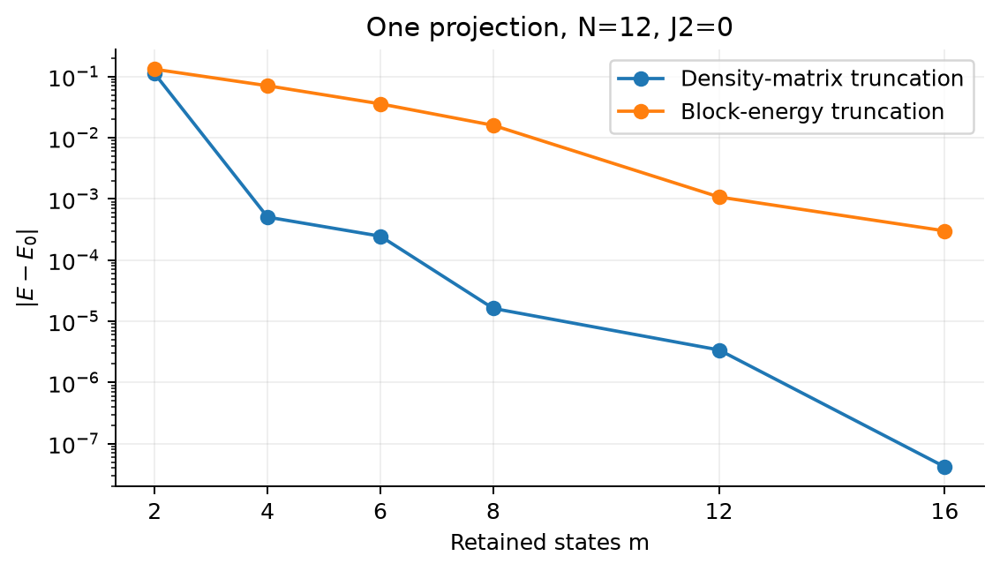

单次投影的能量误差比较；两种方法使用同一个原始开链哈密顿量评估。

## 必做 3：infinite DMRG 生长

取 $J_2=0,\chi=32$。前七行生长到题目要求的 $N=16$；后两行是为 $N=20$ 有限扫描继续进行的 warmup。实际保留维数指截断后左右块各自的维数；小尺寸尚未达到上限。

| $N$ | 实际保留维数 | 能量 $E$ | $E/N$ | $\varepsilon_{\max}$ | ED 误差 |
| --- | --- | --- | --- | --- | --- |
| 4 | 4/4 | -1.616025403784 | -0.404006350946 | 1.1102e-16 | 4.4409e-16 |
| 6 | 8/8 | -2.493577133888 | -0.415596188981 | 0.0000e+00 | 1.3323e-15 |
| 8 | 16/16 | -3.374932598688 | -0.421866574836 | 6.6613e-16 | 4.4409e-16 |
| 10 | 32/32 | -4.258035207283 | -0.425803520728 | 7.7716e-16 | 1.0658e-14 |
| 12 | 32/32 | -5.142090632841 | -0.428507552737 | 3.3418e-13 | 1.7764e-15 |
| 14 | 32/32 | -6.026724661828 | -0.430480332988 | 7.8223e-11 | 3.4034e-11 |
| 16 | 32/32 | -6.911737137886 | -0.431983571118 | 1.1220e-11 | 7.6891e-09 |
| 18 | 32/32 | -7.797011043456 | -0.433167280192 | 5.5312e-10 | 2.5081e-08 |
| 20 | 32/32 | -8.682473274453 | -0.434123663723 | 1.3817e-10 | 5.9946e-08 |

上表固定上限为 $\chi=32$，丢弃权重取本步左右截断中较大者。前几步的机器精度微小权重不表示物理截断；块尺寸超过上限后发生真实截断。小尺寸与必做 1 的精确能量对上；更长链另外使用独立稀疏 ED 对照，并将每个生长态恢复到原始比特基底直接计算能量。

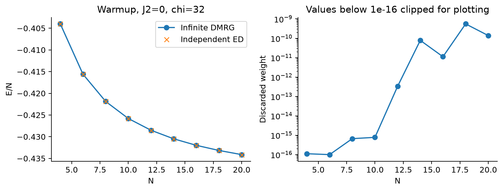

生长阶段的能量密度和丢弃权重；绘图对低于 $10^{-16}$ 的权重设置显示下限，表格保留原值。

## 必做 4：finite DMRG 扫描

### $J_2=0.0$，$N=20,\chi=32$

独立精确参照为 $E_0=-8.682473334399$。

| 完整 sweep | 能量 $E$ | $|E-E_0|$ | 本轮最大丢弃权重 |
| --- | --- | --- | --- |
| warmup | -8.682473274453 | 5.9946e-08 | 1.3817e-10 |
| 1 | -8.682473320091 | 1.4308e-08 | 9.9137e-10 |
| 2 | -8.682473320090 | 1.4309e-08 | 9.9139e-10 |

与 warmup 相比，最终能量降低 $4.5637e-08$；最后两次中点能量变化为 $1.9540e-13$。

### $J_2=0.3$，$N=20,\chi=32$

独立精确参照为 $E_0=-7.796938545212$。

| 完整 sweep | 能量 $E$ | $|E-E_0|$ | 本轮最大丢弃权重 |
| --- | --- | --- | --- |
| warmup | -7.796938526715 | 1.8497e-08 | 1.4416e-10 |
| 1 | -7.796938543203 | 2.0085e-09 | 1.4918e-10 |
| 2 | -7.796938543203 | 2.0089e-09 | 1.4919e-10 |

与 warmup 相比，最终能量降低 $1.6488e-08$；最后两次中点能量变化为 $4.2188e-13$。

有限扫描重新优化不同切口处的块基，因此比只生长一次能更好地适配固定长度的环境。这里 $\chi=32$ 的 warmup 本来已很准确，能量改善量较小；每轮结果仍以恢复到物理基底的能量期望值独立核对。

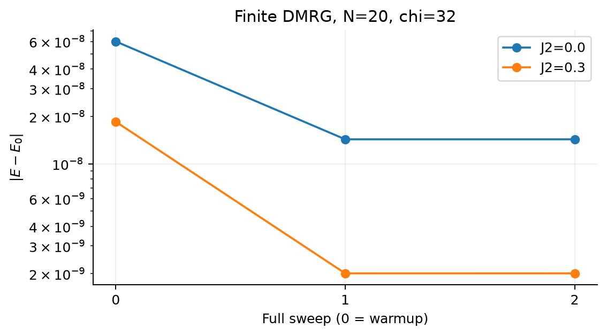

两组耦合下的有限扫描误差；横坐标 0 为生长阶段结束。

## 必做 5：收敛诊断与能量方差

固定 $N=20,J_2=0$，精确参照 $E_0=-8.682473334399$。丢弃权重同时报告最后一整轮的最大值和最终中点值，避免只挑误差较小的切口。

| $\chi$ | 最终 $E$ | $|E-E_0|$ | 最大丢弃权重 | 中点丢弃权重 | sweep 数 |
| --- | --- | --- | --- | --- | --- |
| 2 | -8.330362182711 | 3.5211e-01 | 1.9677e-02 | 5.7965e-03 | 8 |
| 4 | -8.654800162131 | 2.7673e-02 | 1.1913e-03 | 7.7121e-05 | 3 |
| 8 | -8.682079662436 | 3.9367e-04 | 1.8936e-05 | 1.8936e-05 | 3 |
| 16 | -8.682469587405 | 3.7470e-06 | 5.7526e-07 | 5.7526e-07 | 3 |
| 32 | -8.682473320090 | 1.4309e-08 | 9.9139e-10 | 1.4391e-10 | 2 |

全部固定 $\chi$ 计算均达到所设扫描停止条件。$\chi=2$ 需要更多扫描才稳定，但稳定后的能量仍明显偏离精确值：迭代收敛不能替代保留维数收敛。判断 $\chi$ 是否够大，优先观察跨切口的丢弃权重，并同时增大 $\chi$ 核对能量和目标观测量是否稳定；已知精确值时，再以真实能量误差量化。不存在脱离所需精度的统一“够大”阈值。

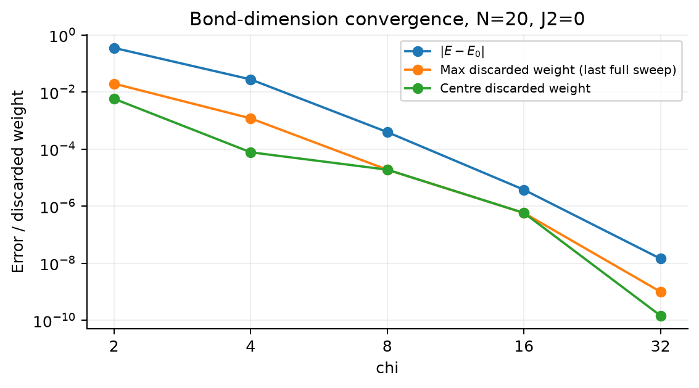

能量误差与两种口径的丢弃权重随保留维数下降；它们相关，但不是同一个量。

### 精确基态能量方差

$$
\mathrm{Var}(H)=\langle H^2\rangle-\langle H\rangle^2=\|(H-E)|\psi\rangle\|^2.
$$

| $N$ | $J_2$ | 直接相减 | 残差范数平方 | 独立张量算符残差平方 |
| --- | --- | --- | --- | --- |
| 12 | 0.0 | -1.7764e-14 | 3.1861e-30 | 3.9249e-30 |
| 12 | 0.5 | -1.0658e-14 | 1.6217e-23 | 1.6217e-23 |

精确本征态的理论方差为零。直接相减可能得到舍入量级的正数或负数，后者不表示物理上的负方差；残差范数平方更稳定。小方差只说明该态接近所用哈密顿量的本征态，仍需解析解与独立算符实现来核对哈密顿量本身。

## 必做校检：小尺寸和 MG 点

### 开边界与周期边界

两格点全空间谱检验单重态 $-3J_1/4$ 和三重态 $J_1/4$（三重简并），且所有已用 ED 矩阵均满足厄米性。下表取 $J_2=0$；周期环比开链多出连接两端的最近邻键，相关能不能用一个固定常数直接扣除，因为基态也会重新调整。

| $N$ | 开链基态能量 | 周期环基态能量 | 开链减周期 |
| --- | --- | --- | --- |
| 4 | -1.616025403784 | -2.000000000000 | 0.383974596216 |
| 6 | -2.493577133888 | -2.802775637732 | 0.309198503844 |
| 8 | -3.374932598688 | -3.651093408937 | 0.276160810249 |

周期参照按对所有 $j$ 求和并取模定义。若以后比较 $N=4$ 且 $J_2\ne0$ 的环，次近邻对在该求和中出现两次；本表 $J_2=0$，不涉及这一小尺寸约定。

### Majumdar–Ghosh 点

$$
J_2=J_1/2,\quad |D_0\rangle=\bigotimes_{m=0}^{N/2-1}\frac{|\uparrow\downarrow\rangle-|\downarrow\uparrow\rangle}{\sqrt2},\quad E_0=-\frac{3N J_1}{8}.
$$

每对单重态中 $\mathbf S_{2m}+\mathbf S_{2m+1}$ 湮灭该态，相邻二聚体之间的一条最近邻键和两条半强度次近邻键相互抵消；每个内部二聚体贡献 $-3J_1/4$。这提供独立于本征值求解器的解析态与解析能量。

| $N$ | ED 能量 | 解析能量 | 二聚体本征残差 | $|\langle D_0|\psi_{ED}\rangle|^2$ |
| --- | --- | --- | --- | --- |
| 8 | -3.000000000000 | -3.000000000000 | 0.0000e+00 | 1.000000000000 |
| 10 | -3.750000000000 | -3.750000000000 | 2.7195e-16 | 1.000000000000 |
| 12 | -4.500000000000 | -4.500000000000 | 5.2074e-16 | 1.000000000000 |
| 14 | -5.250000000000 | -5.250000000000 | 4.4409e-16 | 1.000000000000 |
| 16 | -6.000000000000 | -6.000000000000 | 6.9111e-16 | 1.000000000000 |

残差定义为 $\|H|D_0\rangle-E_0|D_0\rangle\|$，重叠取模平方以消除全局相位。

| $N$ | 切口 $l=1,\ldots,N/2$ 的熵（依次） |
| --- | --- |
| 8 | 0.693147181, 0.000000000, 0.693147181, 0.000000000 |
| 10 | 0.693147181, 0.000000000, 0.693147181, 0.000000000, 0.693147181 |
| 12 | 0.693147181, 0.000000000, 0.693147181, 0.000000000, 0.693147181, 0.000000000 |
| 14 | 0.693147181, 0.000000000, 0.693147181, 0.000000000, 0.693147181, 0.000000000, 0.693147181 |
| 16 | 0.693147181, 0.000000000, 0.693147181, 0.000000000, 0.693147181, 0.000000000, 0.693147181, 0.000000000 |

奇数切口切断一个单重态，熵为 $\ln2$；偶数切口位于两个二聚体之间，熵为零。ED 基态所得剖面与解析二聚体结构一致。

## 独立校检策略与故意注错

完整逐条清单见 output/validation.md，每项都记录错误类型、期望值、实测值、容差及结论。主运行共 611 项检查，全部通过。下面按类型归纳；厄米性、归一化、求解器残差均仅作为辅助，不能替代独立物理核验。

| 校检类型 | 针对的错误 | 错误时如何失败 |
| --- | --- | --- |
| 两格点解析谱 | 自旋因子或相互作用符号 | 谱与单重态/三重态解析值不符 |
| 原始位基 ED 对超块 | J2 漏键、边缘位置、重整化错误 | 物理态能量与超块结果不符 |
| 局域张量算符对 ED | 位翻转矩阵元、周期回绕、耦合符号 | 同一物理态的 H 作用结果不符 |
| MG 解析能量与态 | J2 系数、错误边界键 | 能量或显式二聚体残差不符 |
| 投影损失与磁化 | 保留权重排序、不同电荷混合 | 范数损失、维数上限或电荷等式不符 |
| SVD 对约化密度矩阵 | 切口、归一化、权重平方 | 两种熵计算不一致 |
| 方差的不同算法 | H 平方或数值相消问题 | 稳定残差与直接相减超容差 |

回归测试还覆盖非各向同性参数及有限扫描的全部局部位置；在小尺寸下逐个恢复局部优化态并与独立物理哈密顿量核对，避免仅检查扫描结束位置。完整主计算独立展开了每个生长态和每轮完整扫描结束态。

| 故意注入的错误 | 检测不符量 | 捕获 |
| --- | --- | --- |
| omit J2 | 7.5000e-01 | 是 |
| periodic wrap | 4.6683e-01 | 是 |
| wrong J2 sign | 1.5000e+00 | 是 |
| zero second boundary operators | 4.5819e-02 | 是 |

重要反例：MG 二聚体在周期环上也可能满足相同的能量关系，因此仅靠 MG 态能量不能可靠发现增加回绕键。周期键注错特意改用一般测试向量，与独立的开链局域张量算符逐项作用对比。所有注错均使用独立对象，未污染最终计算。

物理态能量复核：75 项，最大实测偏差 $4.9738e-14$。

投影损失复核：6 项，最大实测偏差 $2.3368e-15$。

磁化守恒：6 项，最大实测偏差 $0.0000e+00$。

截断等距性：6 项，最大实测偏差 $5.6230e-15$。

局域张量算符复核：14 项，最大实测偏差 $4.2140e-15$。

## 选做 1：纠缠剖面与典型态

| 切口 $l$ | $J_2=0$ 的 $S(l)$ | $J_2=0.5$ 的 $S(l)$ |
| --- | --- | --- |
| 1 | 0.693147181 | 0.693147181 |
| 2 | 0.420477197 | 0.000000000 |
| 3 | 0.732745447 | 0.693147181 |
| 4 | 0.530693630 | 0.000000000 |
| 5 | 0.759169835 | 0.693147181 |
| 6 | 0.578321710 | 0.000000000 |
| 7 | 0.771792053 | 0.693147181 |
| 8 | 0.592307034 | 0.000000000 |
| 9 | 0.771792053 | 0.693147181 |
| 10 | 0.578321710 | 0.000000000 |
| 11 | 0.759169835 | 0.693147181 |
| 12 | 0.530693630 | 0.000000000 |
| 13 | 0.732745447 | 0.693147181 |
| 14 | 0.420477197 | 0.000000000 |
| 15 | 0.693147181 | 0.693147181 |

两组均通过 $S(l)=S(N-l)$ 的数值核对。$J_2=0$ 的最大值位于切口 [7, 9]；MG 点的最大值位于所有奇数切口 [1, 3, 5, 7, 9, 11, 13, 15]。开边界引起的奇偶振荡使最大值不必恰在中点。

| $N$ | 乘积态 | Néel 态 | GHZ 态 | 随机纯态 |
| --- | --- | --- | --- | --- |
| 4 | 0.000000000 | 0.000000000 | 0.693147181 | 0.907417827 |
| 8 | 0.000000000 | 0.000000000 | 0.693147181 | 2.234302058 |
| 12 | 0.000000000 | 0.000000000 | 0.693147181 | 3.654319806 |
| 16 | 0.000000000 | 0.000000000 | 0.693147181 | 5.043163076 |

乘积态取所有局域态为 $(|\downarrow\rangle+|\uparrow\rangle)/\sqrt2$，Néel 态为交替自旋的单个组态，GHZ 态取全下和全上的等幅叠加，随机态由独立复高斯系数归一化，种子为 20261019+N。这一部分不限制总磁化。

乘积态和 Néel 态无纠缠，GHZ 态的任意非平凡切口熵恒为 $\ln2$，均符合一维面积律的有界熵特征；一般随机纯态的中点熵随系统长度增长，体现体积律。MG 基态具有严格有界的二聚体纠缠。$J_2=0$ 链的剖面不能仅凭一个尺寸就证明严格面积律；应区分临界体系可能的对数修正与体积律。

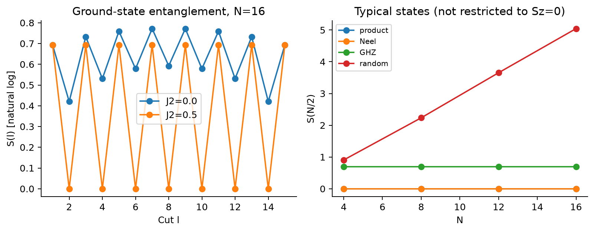

完整纠缠剖面，以及四类典型态在不同系统长度下的中点纠缠熵。

## 选做 2：保留维数外推

严格按题目要求，对 $\chi=4,8,16,32$ 的能量与 $1/\chi$ 做无权线性最小二乘拟合。

$$
E(\chi)=a/\chi+b,\qquad a=0.131008337854,\quad b=-8.690808222608.
$$

| 估计方式 | 能量 | 与 ED 的绝对误差 |
| --- | --- | --- |
| $\chi=32$ | -8.682473320090 | 1.4309e-08 |
| $1/\chi$ 线性外推截距 | -8.690808222608 | 8.3349e-03 |
| ED 参照 | -8.682473334399 | 0（参照自身） |

本次线性外推没有改善精度，而且落到精确能量以下。各个 DMRG 能量是变分上界，但拟合截距不是变分态的期望值，不受同样的上界约束。误差随 $\chi$ 并不呈简单的 $1/\chi$ 线性趋势，尤其小 $\chi$ 点偏离精确值较大，直接外推会产生模型误差。

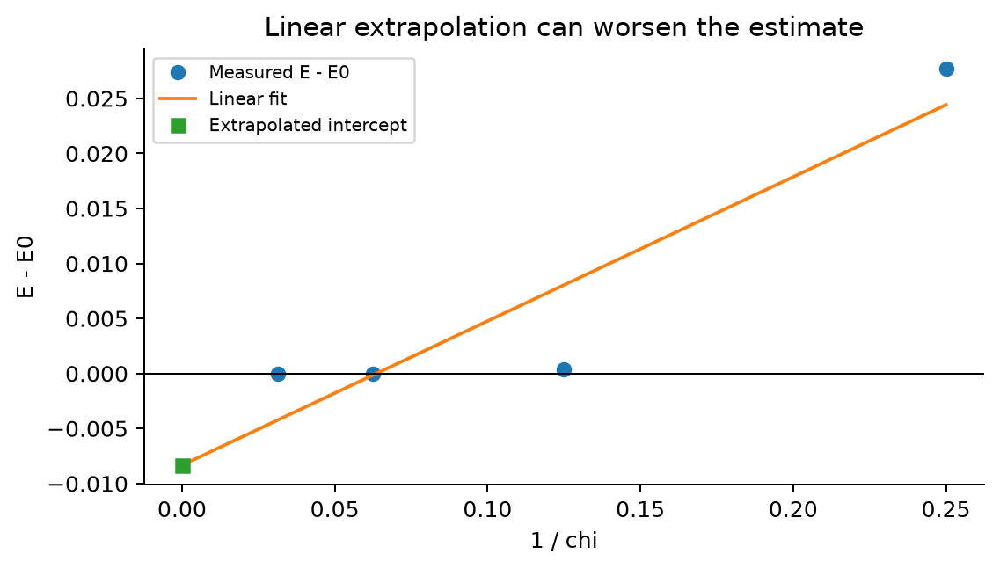

按题目指定横坐标进行的线性外推；截距比最准确的直接计算更差。

### 能量误差与丢弃权重的定量关系

充分扫描后，可以用丢弃权重而非 $1/\chi$ 作为能量外推的横坐标；近似正比关系需要在具体系统中检查，不能预先当作定律。White 对截断权重外推的讨论也强调环境基不完整可能低估实际截断误差，以及必须核查线性。 [White（2005），第 4 页及图 4](https://arxiv.org/abs/cond-mat/0508709)。

固定 $N=20,J_2=0$，使用与前述外推相同的 $\chi=4,8,16,32$ 四个已收敛结果；误差取总能量的 $\mathrm{err}=|E-E_0|$，主分析中 $\varepsilon$ 为最后一整轮 sweep 的最大丢弃权重，不混用 warmup 或不同长度数据。

| $\chi$ | $\mathrm{err}$ | $\varepsilon_{\max}$ | $\mathrm{err}/\varepsilon_{\max}$ | $\varepsilon_{\mathrm{centre}}$ |
| --- | --- | --- | --- | --- |
| 4 | 2.7673e-02 | 1.1913e-03 | 23.228654 | 7.7121e-05 |
| 8 | 3.9367e-04 | 1.8936e-05 | 20.789190 | 1.8936e-05 |
| 16 | 3.7470e-06 | 5.7526e-07 | 6.513517 | 5.7526e-07 |
| 32 | 1.4309e-08 | 9.9139e-10 | 14.432743 | 1.4391e-10 |

对四个点做无权对数最小二乘拟合，每个数量级上的相对偏差具有相同权重：

$$
\log\mathrm{err}=p\log\varepsilon+\log A,\qquad p=1.046094,\quad A=26.793976,\quad R^2_{\log}=0.993378.
$$

斜率接近 1，支持该数据范围内 $\mathrm{err}$ 随 $\varepsilon$ 近似一阶下降。强制过原点拟合 $\mathrm{err}=k\varepsilon$ 得 $k=23.228034$，但未加权线性拟合受大误差点主导；实测比值从 6.513517 到 23.228654，说明严格正比系数并不稳定。四点拟合的高 $R^2$ 也不能作为普适标度或统计置信区间。

| 丢弃权重口径 | 幂指数 $p$ | $R^2_{\log}$ |
| --- | --- | --- |
| 最后整轮最大值 | 1.046094 | 0.993378 |
| 最终中点值 | 1.008507 | 0.920222 |

口径敏感性说明单个切口的局部权重不能不加说明地代表整条链的总误差。为理解近似正比的来源，若从精确基态做一次投影并归一化，保留态与精确基态的重叠平方恰为 $1-\varepsilon$；将该态按原始哈密顿量本征态展开，有：

$$
E-E_0=\sum_{n>0}|c_n|^2(E_n-E_0)=\varepsilon\,\overline{\Delta E},\qquad \sum_{n>0}|c_n|^2=\varepsilon.
$$

只有有效激发能尺度 $\overline{\Delta E}$ 变化不大时才近似正比。实际 DMRG 经历多个切口的截断和重新优化，所报局部 $\varepsilon_{\max}$ 不等于最终态的总失真权重，因此上述单次精确投影恒等式不能直接当作本计算的严格误差公式。

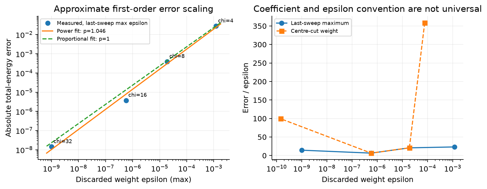

误差与丢弃权重的双对数拟合，以及不同权重口径下的误差/权重比值。

再尝试四点无权线性外推 $E(\varepsilon)=E_*+a\varepsilon$。为避免大常数相消，先对有符号的 $E-E_0$ 拟合截距，再加回 $E_0$；独立的缩放设计矩阵最小二乘用于复核。

$$
a=23.243863,\qquad E_*=-8.682491893134.
$$

| 估计方法 | 能量 | 对 ED 的绝对误差 |
| --- | --- | --- |
| $1/\chi$ 四点线性外推 | -8.690808222608 | 8.3349e-03 |
| $\varepsilon_{\max}$ 四点线性外推 | -8.682491893134 | 1.8559e-05 |
| 直接 $\chi=32$ | -8.682473320090 | 1.4309e-08 |

这次用 $\varepsilon$ 外推比用 $1/\chi$ 外推更接近精确值，但仍不如直接保留 32 个态的结果。近似线性趋势可用于诊断，不能保证外推一定改善精度；截距也不受变分上界约束。

## 选做 3：更长开链与热力学极限

固定 $J_1=1,\Delta=1,J_2=0$，将同一传统 DMRG 扩展到 $N=40,60$，分别取 $\chi=32,64$。仅使用保持磁化的截断块，不展开长链的完整自旋空间。题给无限均匀链能量密度为：

$$
e_\infty=\frac14-\ln2=-0.443147180560.
$$

| $N$ | $\chi$ | 最终 $E$ | $E/N$ | $E/N-e_\infty$ | 最大丢弃权重 | 轮数 |
| --- | --- | --- | --- | --- | --- | --- |
| 40 | 32 | -17.541472113764 | -0.438536802844 | 4.6104e-03 | 3.2499e-08 | 2 |
| 40 | 64 | -17.541473298400 | -0.438536832460 | 4.6103e-03 | 4.0398e-11 | 2 |
| 60 | 32 | -26.403006572863 | -0.440050109548 | 3.0971e-03 | 1.3342e-07 | 3 |
| 60 | 64 | -26.403015114915 | -0.440050251915 | 3.0969e-03 | 4.9161e-10 | 2 |

所有长链计算均达到相邻完整 sweep 中点能量变化小于 $10^{-9}$ 的停止条件。下表把同一尺寸增加保留维数的变化，与有限开链能量密度距无限链的差分开：

| $N$ | $\chi=32\to64$ 的 $|\Delta(E/N)|$ | $\chi=64$ 的 $E/N-e_\infty$ | $N(E/N-e_\infty)$ |
| --- | --- | --- | --- |
| 40 | 2.9616e-08 | 4.6103e-03 | 0.184413923998 |
| 60 | 1.4237e-07 | 3.0969e-03 | 0.185815718682 |

有限开链缺少跨越两端的键，端点附近的关联也随之调整；总能量含有有限的边界贡献，除以 $N$ 后表现为约 $1/N$ 的偏离，并叠加其他有限尺寸修正。本次增大 $N$ 明显缩小偏差，而同一尺寸增大 $\chi$ 的影响小得多，说明表中距无限链值的差主要来自有限长度和边界。

这里没有把有限开链与无限链的差直接当作 DMRG 算法误差，也没有把两个长度的结果拟合成已知精度的热力学极限。两个长度、两种保留维数只能展示误差变化；若要求严格的极限精度，还需要更多尺寸和更系统的截断收敛分析。

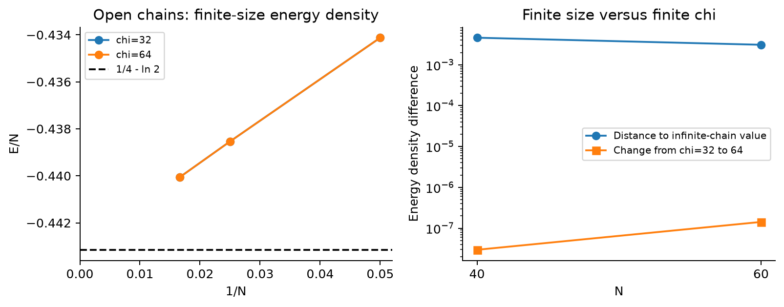

开链能量密度逐渐接近无限链值；右图比较有限长度偏差与增加保留维数带来的变化。

### 长链的独立物理校检

从保存的块等距矩阵逐格点恢复物理 MPS，再以独立定义的局域 $S^x,S^y,S^z$ 做左右环境收缩，计算每条最近邻和次近邻关联，并重新求和得到能量。这条路径不调用重整化哈密顿量和边缘算符；漏掉键、右块方向错误或算符投影不一致时，会与超块能量不符。每轮完整扫描都执行该检查，并核对 MPS 范数。

| $N$ | $\chi$ | 物理关联求和能量 | 与超块能量之差 | MPS 范数 |
| --- | --- | --- | --- | --- |
| 40 | 32 | -17.541472113764 | 1.7764e-14 | 1.000000000000 |
| 40 | 64 | -17.541473298400 | 2.4869e-14 | 1.000000000000 |
| 60 | 32 | -26.403006572863 | 5.3291e-14 | 1.000000000000 |
| 60 | 64 | -26.403015114915 | 5.3291e-14 | 1.000000000000 |

新增测试以小系统原始比特态核对全部键，包括左右长度不同的随机态和任意虚拟基变换，避免反射对称掩盖位序错误。另以 40 格点显式单重态乘积 MPS 核对解析的强弱键剖面。长链张量保存于 output/data/mps_N*.npz，可直接重建并复测，不需要指数空间。

## 选做 4：二聚化关联与有限尺寸限制

固定 $\Delta=1$，扫描 $J_2=0,0.1,\ldots,1.0$。主计算使用 $N=20,\chi=64$ 的有限 DMRG，并逐点与独立精确对角化对照；另计算 $N=12,16$ 的精确结果作为有限尺寸比较。定义：

$$
C_j=\langle\mathbf S_j\cdot\mathbf S_{j+1}\rangle,\qquad D_N=\left|C_{N/2-2}-C_{N/2-1}\right|.
$$

格点与键均从 0 开始编号。$N=20$ 时比较的是 $C_8$ 和 $C_9$，即紧邻中点的两条相邻键。保存带符号的差和绝对值，绘图用绝对值；完整逐键关联在 output/data/dimer_bonds.csv，原始结果与校检在 results.json。

| $J_2$ | $C_8$ | $C_9$ | $D_{20}$ | 与 ED 的 $|\Delta D|$ | 最大逐键误差 |
| --- | --- | --- | --- | --- | --- |
| 0.0 | -0.523876104069 | -0.363847566396 | 0.160028537673 | 1.8407e-12 | 5.0520e-12 |
| 0.1 | -0.541723342518 | -0.345039468316 | 0.196683874201 | 1.2386e-12 | 3.9167e-12 |
| 0.2 | -0.569204259991 | -0.313646041862 | 0.255558218128 | 4.5058e-12 | 2.8416e-12 |
| 0.3 | -0.616892376159 | -0.255002211921 | 0.361890164239 | 1.6579e-11 | 1.0909e-11 |
| 0.4 | -0.696713008548 | -0.141771939127 | 0.554941069421 | 1.4081e-11 | 9.6845e-12 |
| 0.5 | -0.750000000000 | -0.000000000000 | 0.750000000000 | 3.1197e-14 | 3.2194e-13 |
| 0.6 | -0.706347521264 | 0.082059926845 | 0.788407448109 | 3.6795e-10 | 3.1998e-10 |
| 0.7 | -0.619310428838 | 0.117301287717 | 0.736611716555 | 2.6063e-08 | 1.8185e-08 |
| 0.8 | -0.526921123522 | 0.125400671335 | 0.652321794857 | 2.8513e-07 | 2.2216e-07 |
| 0.9 | -0.445985893245 | 0.123017984314 | 0.569003877559 | 1.4603e-06 | 9.2275e-07 |
| 1.0 | -0.380335424425 | 0.120818045677 | 0.501153470102 | 2.7899e-06 | 1.6317e-06 |

### 精确有限尺寸对照

| $J_2$ | $D_{12}$（ED） | $D_{16}$（ED） | $D_{20}$（ED） |
| --- | --- | --- | --- |
| 0.0 | 0.217477475577 | 0.182932352284 | 0.160028537671 |
| 0.1 | 0.262826126173 | 0.223324147095 | 0.196683874200 |
| 0.2 | 0.329834998797 | 0.286035452404 | 0.255558218124 |
| 0.3 | 0.433956652272 | 0.392195235903 | 0.361890164222 |
| 0.4 | 0.590037273474 | 0.569216861454 | 0.554941069407 |
| 0.5 | 0.750000000000 | 0.750000000000 | 0.750000000000 |
| 0.6 | 0.790017766841 | 0.788079468776 | 0.788407447741 |
| 0.7 | 0.736817312536 | 0.739802426271 | 0.736611690492 |
| 0.8 | 0.666341178246 | 0.661931516891 | 0.652321509729 |
| 0.9 | 0.606118107116 | 0.575472938951 | 0.569002417242 |
| 1.0 | 0.554730585539 | 0.494944095520 | 0.501150680219 |

本次有限尺寸曲线在 $J_2\approx0.2$ 至 $0.5$ 的区间交替明显增强，网格上的最大值出现在 $J_2=0.6$。之后交替强度降低，不能把它简单理解为随挫折耦合单调增长。MG 点 $J_2=0.5$ 的强键关联为 $-3/4$、弱键为零，因此 $D_N=3/4$，与全部三个尺寸的计算一致。

“首次出现非零交替”不能用作本组有限开链的相变判据：即使 $J_2=0$，边界也诱导交替，其中心值依次为 $0.217477475577$、$0.182932352284$、$0.160028537671$，随长度变化。本结果能说明有限系统的键交替随耦合增强及其尺寸依赖；不能单独证明热力学极限存在非零自发序参量，也不能从 0.1 的扫描间隔确定临界耦合。

若要定位真正的二聚化转变，还需更长链、更多尺寸、更细耦合网格，并对边界诱导振荡和保留维数做系统分析。本次不把平滑增强的有限尺寸曲线标成精确相变点。

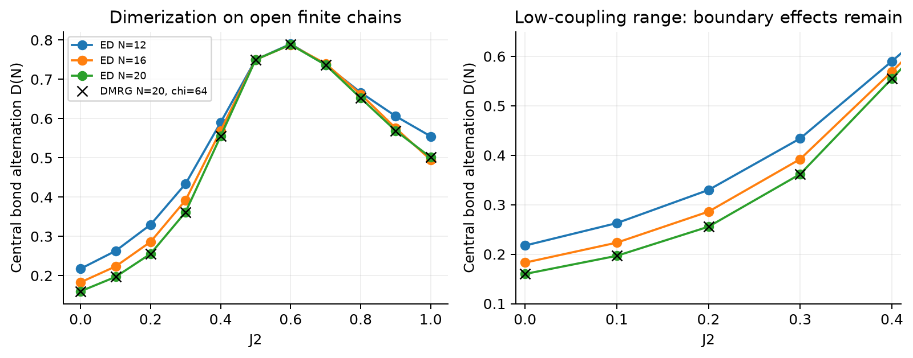

中心键交替强度随耦合的变化；DMRG 与精确结果重合，低耦合区仍可见有限尺寸和边界效应。

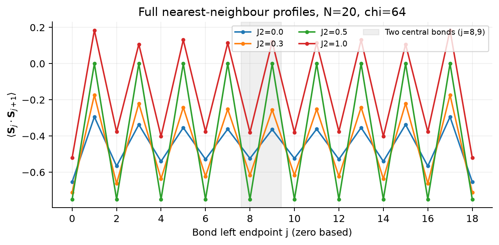

代表性耦合下的全部最近邻键关联，阴影标出用于定义二聚化强度的两条键。

### 已知相图对照与同尺寸基线扣除

已知零场、各向同性的反铁磁链在 $g=J_2/J_1\lesssim g_c\simeq0.2411$ 为无隙自旋流体，相变后出现自发二聚化及自旋能隙；该转变属于 BKT 类型。$g=0.5$ 的 MG 点位于二聚化相内部，而非相界。这里的相界数值来自文献，用作对照，不是本次有限尺寸数据拟合出的结果。 [White 与 Affleck（1996），第 II 节](https://arxiv.org/abs/cond-mat/9602126), [Nomura 与 Okamoto（1994）](https://doi.org/10.1088/0305-4470/27/17/012)。

| 文献区间 | 热力学极限性质 | 本次网格的对应点 |
| --- | --- | --- |
| $0\le g<g_c$ | 无隙；不具有自发二聚化 | 0、0.1、0.2 |
| $g\approx g_c$ | BKT 转变；临界附近有限尺寸困难 | 位于 0.2 与 0.3 之间 |
| $g_c<g\le1$ | 有隙二聚化相 | 0.3 至 1.0；0.5 为精确二聚体点 |

因而本报告中有限开链在 $J_2\approx0.2$ 至 $0.5$ 的平滑增强与已知相图相容；网格上 $J_2=0.6$ 的最大交替强度不是二聚化的起点，也不是另一条相界。BKT 转变附近能隙与序参量可以很小，不能期待 $N\le20$ 的粗网格曲线直接显示突变。

为去掉同一有限链在无挫折点已有的背景，定义用于展示相对增强的量：

$$
\Delta D_N(J_2)=D_N(J_2)-D_N(0),\qquad D_N(J_2)=|C_{N/2-2}(J_2)-C_{N/2-1}(J_2)|.
$$

基线在相同 $N$、边界条件、方法和保留维数下取值。先对原始键差取绝对值，再减去基线；不把它改成两组带符号键差相减后再取绝对值。全部原始 $D_N$ 仍保留，未用扣除值替换原来的序参量定义。

| $N$ | ED 基线 $D_N(0)$ |
| --- | --- |
| 12 | 0.217477475577 |
| 16 | 0.182932352284 |
| 20 | 0.160028537671 |

| $J_2$ | $\Delta D_{12}$（ED） | $\Delta D_{16}$（ED） | $\Delta D_{20}$（ED） | $\Delta D_{20}$（DMRG） |
| --- | --- | --- | --- | --- |
| 0.0 | 0.000000000000 | 0.000000000000 | 0.000000000000 | 0.000000000000 |
| 0.1 | 0.045348650597 | 0.040391794810 | 0.036655336529 | 0.036655336528 |
| 0.2 | 0.112357523220 | 0.103103100119 | 0.095529680453 | 0.095529680455 |
| 0.3 | 0.216479176696 | 0.209262883619 | 0.201861626551 | 0.201861626565 |
| 0.4 | 0.372559797898 | 0.386284509170 | 0.394912531736 | 0.394912531748 |
| 0.5 | 0.532522524423 | 0.567067647716 | 0.589971462329 | 0.589971462327 |
| 0.6 | 0.572540291264 | 0.605147116491 | 0.628378910069 | 0.628378910435 |
| 0.7 | 0.519339836959 | 0.556870073987 | 0.576583152821 | 0.576583178882 |
| 0.8 | 0.448863702669 | 0.478999164607 | 0.492292972058 | 0.492293257184 |
| 0.9 | 0.388640631540 | 0.392540586667 | 0.408973879570 | 0.408975339886 |
| 1.0 | 0.337253109962 | 0.312011743236 | 0.341122142548 | 0.341124932428 |

扣除后 $J_2=0$ 的各尺寸曲线严格归零，更容易比较挫折带来的额外交替。以低于文献临界点的 $J_2=0.2$ 为例，$\Delta D_{20}=0.095529680453$ 仍为正，说明这种相对增强并不等同于自发长程序。

边界诱导的响应随 $J_2$ 和关联长度改变，减去一个 $J_2=0$ 常数不能消除全部边界效应。扣除值依然不能用来确定 $g_c$、证明有隙，或证明 $N\to\infty$ 后序参量非零；应结合更大尺寸外推、能隙或能级交叉等独立诊断。

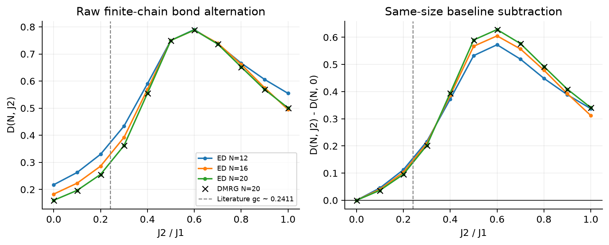

原始中心键交替与同尺寸基线扣除后的曲线；虚线为文献参考相界，未由本数据反推。

### 独立校检与精度

每个耦合点以三条路径交叉核验：DMRG 的物理 MPS 收缩、同一近似态展开后的比特关联、独立 ED 基态关联。每个尺寸的两条中心键再用局域 2×2 张量作用复核，并用全部键关联重组 ED 能量。

| $J_2$ | DMRG 能量 | ED 能量 | 能量绝对误差 | 最大丢弃权重 |
| --- | --- | --- | --- | --- |
| 0.0 | -8.682473334398 | -8.682473334399 | 7.3896e-13 | 6.7724e-14 |
| 0.1 | -8.362950950930 | -8.362950950931 | 3.2152e-13 | 3.4195e-14 |
| 0.2 | -8.064121443906 | -8.064121443907 | 7.4429e-13 | 5.6510e-14 |
| 0.3 | -7.796938545210 | -7.796938545212 | 1.8350e-12 | 1.3167e-13 |
| 0.4 | -7.587941015406 | -7.587941015407 | 9.0505e-13 | 6.3283e-14 |
| 0.5 | -7.500000000000 | -7.500000000000 | 7.1054e-15 | 2.8866e-15 |
| 0.6 | -7.600533568914 | -7.600533568963 | 4.9313e-11 | 3.4824e-12 |
| 0.7 | -7.890871254482 | -7.890871258006 | 3.5238e-09 | 2.4687e-10 |
| 0.8 | -8.332610651309 | -8.332610706194 | 5.4885e-08 | 2.6452e-09 |
| 0.9 | -8.884520248996 | -8.884520506178 | 2.5718e-07 | 1.3044e-08 |
| 1.0 | -9.513883839296 | -9.513884429134 | 5.8984e-07 | 3.6217e-08 |

对实际 MPS 测量程序注入横向系数加倍的错误后，单重态键关联从期望的 -0.750000000000 变成 -1.250000000000，被解析关联检查捕获；随后恢复正确算符。全部新增校检连同期望、实测和针对的错误类型，均已并入 output/validation.md。

## 源码、复现与开发修正

| 文件 | 职责 |
| --- | --- |
| src/core.py | 比特 ED、块扩大、超块作用、分块 SVD、统一投影、生长与扫描 |
| src/analysis.py | 二聚体、纠缠熵、单次截断实验、独立局域张量算符 |
| src/mps_observables.py | 从块等距矩阵恢复物理 MPS、可扩展关联测量及独立比特关联 |
| src/refinements.py | 误差/丢弃权重拟合及同尺寸基线扣除 |
| tests/test_core.py | 磁化分块、全局上限、零权重、全扫描位置与物理基底验证 |
| tests/test_analysis.py | 二聚体解析解和全部指定 m 值的投影实验 |
| tests/test_mps_observables.py | 不对称随机态、虚拟基变换、物理关联与长二聚体测试 |
| run_homework5.py | 完整数值实验、精确参照、逐条校检、原始态及结果存档 |
| run_optional.py | 长开链和全耦合网格的二聚化实验与独立校检 |
| optional_report.py | 选做 3/4 同源结果表、图、物理讨论及逐键 CSV |
| refine_results.py | 只重算新增分析，复用已独立校检的物理数据 |
| review_report.py | 误差标度、文献相图和基线扣除的图表与讨论 |
| verify_outputs.py | 核对 Markdown/PDF 数值、CSV 和长链 MPS 存档 |
| build_report.py | 从同一 JSON 生成图、独立结果文档、中文说明和 LaTeX 报告 |

开发中修正了一处真实问题：对照实验最初使用全矩阵 SVD，在部分简并值截断时产生磁化泄漏；已改为分磁化 SVD，并将全部指定 m 值纳入测试。另将最低保留维数的扫描上限从 6 增加到 12，确保实际达到收敛阈值。这些修正均在最终结果产生前重新运行验证。

所有结果路径和从干净环境运行的命令见根目录 README.md。report/report.tex 是提交中的 LaTeX 源文件，引用 output/figures 下的图；最终报告只经 XeLaTeX 编译。

用户已明确授权生成 AI 使用记录。项目根目录 AI_USAGE_RECORD.md 保留作业相关 prompt 原文、可见回复要点、文件动作和修改原因台账，应与本报告及源码一同提交。

[AI 使用与对话记录](../AI_USAGE_RECORD.md)
